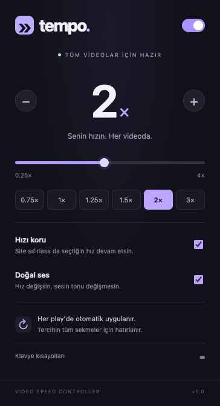

# Tempo — Video Speed Controller

**Your playback speed, remembered.** A lightweight Microsoft Edge extension that reapplies your preferred speed whenever a video starts, resumes, or changes.

[Türkçe](README.tr.md) · [Installation](#installation) · [Contributing](CONTRIBUTING.md) · [MIT License](LICENSE)

<p align="center">
  
</p>

Tempo runs locally, requires no account, and has no runtime dependencies. The current interface is in Turkish; an English control reference is provided below.

## Features

- **Persistent playback speed:** choose a speed between **0.25× and 4×**, with **1.5×** as the default. Your preference is shared across tabs and survives browser restarts.
- **Automatic reapplication:** restores the selected speed on playback, media loading, and seeking events.
- **Speed lock:** reapplies your preference when a website resets the video's speed.
- **Dynamic player support:** discovers videos inserted or replaced during navigation, including matching iframe documents and open shadow roots.
- **Pitch preservation:** keeps voices at their natural pitch when supported by the player.
- **Quick controls:** adjust speed with the slider, presets, increment buttons, or keyboard shortcuts.
- **Reversible control:** disabling Tempo restores the speed and pitch settings captured before Tempo took control of each video.

## Installation

Tempo is installed locally as an unpacked extension. It is not currently distributed through Microsoft Edge Add-ons.

1. [Download the source ZIP](https://github.com/halilozel1903/tempo-video-speed-controller/archive/refs/heads/main.zip), or clone this repository:

   ```sh
   git clone https://github.com/halilozel1903/tempo-video-speed-controller.git
   ```

2. Extract the ZIP to a permanent folder if you downloaded it.
3. Open `edge://extensions` in Microsoft Edge.
4. Enable **Developer mode**, then select **Load unpacked**.
5. Select the repository folder containing `manifest.json`.
6. Refresh any video tabs that were already open. Pin **Tempo** from the extensions menu for quick access.

No Node.js installation or build step is required to use the extension. Keep the loaded folder in place; moving or deleting it will prevent Edge from loading the extension.

For further details, see Microsoft's [local extension installation guide](https://learn.microsoft.com/en-us/microsoft-edge/extensions/getting-started/extension-sideloading).

## Usage

Open Tempo from the Edge toolbar and select your preferred speed. Changes apply to videos on accessible pages across all tabs.

| Control | Behavior |
| --- | --- |
| Power switch | Enable or disable speed control. |
| Slider and presets | Select a speed from 0.25× to 4×. |
| − / + buttons | Decrease or increase speed by 0.1. |
| **Hızı koru** — Speed lock | Restore the selected speed when a website changes it. |
| **Doğal ses** — Natural pitch | Preserve the original audio pitch where supported. |

Speed lock and pitch preservation are enabled by default. When speed lock is off, changes made through a website's player remain in effect until the next playback or media lifecycle event.

### Keyboard shortcuts

| Shortcut | Action |
| --- | --- |
| `Alt` + `Shift` + `↑` | Increase speed by 0.1. |
| `Alt` + `Shift` + `↓` | Decrease speed by 0.1. |
| `Alt` + `Shift` + `0` | Reset speed to 1×. |

On macOS, use **Option (⌥)** for `Alt`. Shortcuts are ignored in text inputs and editable fields. Choosing a speed with a shortcut also enables speed control.

## Privacy and permissions

Tempo does not collect browsing history, send analytics, or make application network requests. Preferences remain on your device in `chrome.storage.local`; they are not synchronized through an external service.

The only extension API permission is **`storage`**. Content scripts run on HTTP, HTTPS, and permitted file URLs, including matching frames, to discover and control video elements. Edge may describe this as access to website data. You can restrict site access in the extension's settings.

Tempo changes HTML5 `<video>` elements. It does not control standalone `<audio>` elements.

## Compatibility and limitations

Tempo targets standard HTML5 video players in Microsoft Edge using Manifest V3. Automated playback checks run in the actual Edge browser, rather than a simulated media player.

- Edge blocks extensions on internal pages such as `edge://` and on protected extension-store pages.
- Local file playback requires **Allow access to file URLs** in Tempo's extension settings.
- Embedded videos require access to their frame origins. Restricting site permissions can prevent these frames from being controlled.
- Closed shadow roots, canvas-based players, and players that reject or continually override playback rates may not be supported.
- Playback rates are subject to the media player's capabilities. Compatibility with every third-party streaming service is not guaranteed.

If a video is not affected, refresh the tab, verify site access, and check whether its player uses a standard video element.

## Development

### Requirements

- Node.js **22 or newer**
- Python **3.9 or newer** for packaging and icon generation
- Microsoft Edge installed in its default location for browser tests

```sh
npm ci
npm test
npm run package
```

The test suite includes **12 Edge integration tests** and **4 startup regression tests**. It covers repeated playback, website speed resets, media source changes, dynamic videos, cross-origin frames, open shadow roots, disabling and restoring controls, keyboard shortcuts, rapid settings changes, and persistence across browser restarts.

Tests create a separate temporary Edge profile and remove it afterward. They do not use your personal browser profile. The small generated WebM fixture is included in the repository, so FFmpeg is not needed to run the tests.

Packaging produces:

| Output | Purpose |
| --- | --- |
| `dist/tempo/` | A clean directory ready for **Load unpacked**. |
| `dist/tempo-edge-1.0.0.zip` | A distributable archive containing the extension, documentation, and license. |

To regenerate the extension icons without third-party libraries, run `python3 scripts/icons.py`.

### Project structure

```text
manifest.json       Edge extension configuration
content.js          Video discovery, playback enforcement, and shortcuts
settings.js         Shared defaults and preference validation
popup.*             Control panel markup, styling, and behavior
icons/              Extension toolbar and listing icons
scripts/            Packaging and icon generation
tests/              Edge integration tests and startup regression tests
```

## Contributing

Bug reports, accessibility improvements, translations, and focused pull requests are welcome. See [CONTRIBUTING.md](CONTRIBUTING.md) for setup instructions and reporting guidelines.

## License

Released under the [MIT License](LICENSE). Copyright © 2026 Halil Özel.
