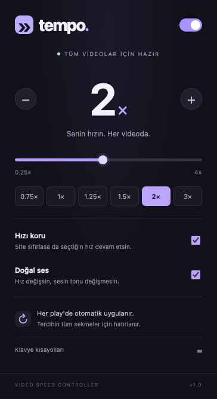

# Tempo — Video Speed Controller

**Seçtiğiniz video hızı, her oynatmada hatırlanır.** Tempo, video başladığında, devam ettiğinde veya değiştiğinde tercih ettiğiniz hızı yeniden uygulayan hafif bir Microsoft Edge extension'ıdır.

[](https://jitpack.io/#halilozel1903/tempo-video-speed-controller)

[English](README.md) · [Katkı rehberi](CONTRIBUTING.md) · [MIT lisansı](LICENSE)

<p align="center">
  
</p>

Tempo yerel olarak çalışır; hesap oluşturmayı gerektirmez ve çalışma zamanı bağımlılığı içermez. Arayüz Türkçedir.

## Özellikler

- **Kalıcı hız tercihi:** 0.25×–4× arasında hız seçimi. Varsayılan hız 1.5×'tir. Tercihiniz tüm sekmelere uygulanır ve browser yeniden açıldığında korunur.
- **Her oynatmada otomatik uygulama:** oynatma, medya yükleme ve ileri/geri sarma olaylarından sonra seçilen hız yeniden uygulanır.
- **Hız kilidi:** site video hızını sıfırladığında tercihiniz geri yüklenir.
- **Dinamik video desteği:** sayfa içinde eklenen veya değiştirilen videolar, eşleşen iframe'ler ve açık shadow root'lar izlenir.
- **Doğal ses:** destekleyen player'larda sesin tonu korunur.
- **Hızlı kontrol:** slider, hazır hızlar, +/− düğmeleri ve klavye kısayolları.
- **Geri alınabilir kontrol:** Tempo kapatıldığında mevcut videoların kontrol öncesinde kaydedilen hız ve ses tonu ayarları geri yüklenir.

## Kurulum

Tempo şu anda Microsoft Edge Add-ons mağazasında yayınlanmamaktadır. Yerel olarak yükleyebilirsiniz:

1. [Son release'teki extension ZIP'ini indirin](https://github.com/halilozel1903/tempo-video-speed-controller/releases/latest) veya repoyu klonlayın:

   ```sh
   git clone https://github.com/halilozel1903/tempo-video-speed-controller.git
   ```

2. ZIP indirdiyseniz kalıcı bir klasöre çıkarın.
3. Edge'de `edge://extensions` sayfasını açın.
4. **Geliştirici modu / Developer mode** seçeneğini etkinleştirin.
5. **Paketlenmemiş öğe yükle / Load unpacked** ile `manifest.json` dosyasının bulunduğu klasörü seçin. Release ZIP'i için çıkarılan `tempo` klasörünü, clone için repo klasörünü kullanın.
6. Açık video sekmelerini yenileyin. Kolay erişim için Tempo'yu araç çubuğuna sabitleyin.

Kullanım için Node.js veya build adımı gerekmez. Edge'in extension'ı yükleyebilmesi için seçtiğiniz klasörü taşımayın veya silmeyin.

Ayrıntılar için [Microsoft'un yerel kurulum rehberine](https://learn.microsoft.com/en-us/microsoft-edge/extensions/getting-started/extension-sideloading) bakabilirsiniz.

## Kullanım

Araç çubuğundan Tempo'yu açıp hızınızı seçin. Değişiklikler erişim izni bulunan tüm sekmelerdeki videolara uygulanır.

| Kontrol | Davranış |
| --- | --- |
| Sağ üstteki anahtar | Hız kontrolünü açar veya kapatır. |
| Slider ve hazır hızlar | 0.25×–4× arasında hız seçer. |
| − / + düğmeleri | Hızı 0.1 azaltır veya artırır. |
| **Hızı koru** | Site hızı değiştirdiğinde seçtiğiniz hızı yeniden uygular. |
| **Doğal ses** | Destekleyen player'larda sesin özgün tonunu korur. |

**Hızı koru** ve **Doğal ses** varsayılan olarak açıktır. Hız kilidi kapalıyken site içindeki hız değişiklikleri bir sonraki oynatma veya medya yaşam döngüsü olayına kadar korunur.

### Klavye kısayolları

| Kısayol | İşlev |
| --- | --- |
| `Alt` + `Shift` + `↑` | Hızı 0.1 artırır. |
| `Alt` + `Shift` + `↓` | Hızı 0.1 azaltır. |
| `Alt` + `Shift` + `0` | 1× normal hıza döner. |

macOS'te `Alt` yerine **Option (⌥)** kullanılır. Kısayollar metin alanlarında çalışmaz. Kısayolla hız seçmek, kapalıysa hız kontrolünü de etkinleştirir.

## Gizlilik ve izinler

Tempo browsing history toplamaz, analytics göndermez ve uygulama kaynaklı ağ isteği yapmaz. Tercihler cihazınızda `chrome.storage.local` içinde saklanır; dış bir hizmetle eşitlenmez.

Tek extension API izni **`storage`** iznidir. Videoları bulmak ve kontrol etmek için HTTP/HTTPS sayfalarında, eşleşen iframe'lerde ve izin verilen dosya URL'lerinde content script çalıştırır. Edge bu erişimi site verilerine erişim olarak gösterebilir. Site erişimini extension ayarlarından kısıtlayabilirsiniz.

Yalnızca HTML5 `<video>` elementleri kontrol edilir; bağımsız `<audio>` elementleri etkilenmez.

## Uyumluluk ve sınırlar

Tempo, Microsoft Edge'deki standart HTML5 video player'larını hedefler ve Manifest V3 kullanır. Otomatik playback kontrolleri gerçek Edge browser'ında çalışır.

- `edge://` sayfaları ve extension mağazası gibi korumalı sayfalarda çalışmaz.
- Yerel dosyalar için extension ayarlarında **Dosya URL'lerine erişime izin ver** seçeneği açılmalıdır.
- Gömülü videolarda iframe origin'ine de erişim gerekir; kısıtlı site izinleri kontrolü engelleyebilir.
- Kapalı shadow root, canvas tabanlı player veya hızı sürekli zorlayan özel player'lar desteklenmeyebilir.
- Kullanılabilir hızlar player'ın yetenekleriyle sınırlıdır. Her üçüncü taraf streaming servisi için uyumluluk garantisi verilmez.

Bir video etkilenmiyorsa sekmeyi yenileyin, site erişimini doğrulayın ve player'ın standart bir video elementi kullanıp kullanmadığını kontrol edin.

## Geliştirme

Node.js **22+**, Python **3.9+** ve varsayılan konumunda kurulu Microsoft Edge gerekir.

```sh
npm ci
npm test
npm run package
```

Test paketi **12 Edge integration test**, **4 başlangıç regression test** ve **1 dağıtım testi** içerir. Gerçek playback, tekrar play, hız sıfırlamaları, medya değişimi, yeni videolar, iframe, açık shadow DOM, ayarların geri yüklenmesi, kısayollar, browser yeniden açıldığında kalıcılık, paket içeriği ve tekrarlanabilir arşiv üretimi doğrulanır.

Testler ayrı bir geçici Edge profili kullanır ve sonrasında siler; kişisel browser profilinize dokunmaz. Üretilmiş küçük WebM fixture repoya dahildir; test için FFmpeg gerekmez.

Paketleme sonucunda `dist/tempo/` yüklenebilir klasörü, `dist/tempo-edge-1.0.1.zip` paylaşılabilir paketi ve SHA-256 doğrulaması için `dist/tempo-edge-1.0.1.zip.sha256` dosyası oluşur. İkonları yeniden üretmek için `python3 scripts/icons.py` çalıştırabilirsiniz.

### JitPack dağıtımı

[Projenin JitPack sayfasını açın](https://jitpack.io/#halilozel1903/tempo-video-speed-controller).

JitPack, `jitpack.yml` içindeki custom build ile extension'ı **ZIP artifact** olarak paketler. Bu isteğe bağlı bir indirme kanalıdır; extension yine Edge'de **Load unpacked** ile yüklenir. Build, Python ve Maven kullanır; Node.js veya browser test bağımlılıkları gerektirmez.

Artifact koordinatları `com.github.halilozel1903:tempo-video-speed-controller:<tag>`, türü `zip` olur. Örneğin v1.0.1 için:

```text
https://jitpack.io/com/github/halilozel1903/tempo-video-speed-controller/v1.0.1/tempo-video-speed-controller-v1.0.1.zip
```

Durum rozeti JitPack build geçmişine yönlendirir. Build logları ve indirme erişimi JitPack tarafından yönetilir. [GitHub release](https://github.com/halilozel1903/tempo-video-speed-controller/releases/latest) ayrı bir indirme kanalı sunar.

## Katkı ve lisans

Hata raporları, erişilebilirlik iyileştirmeleri, çeviriler ve odaklı PR'lar için [katkı rehberini](CONTRIBUTING.md) inceleyebilirsiniz.

Proje [MIT lisansı](LICENSE) ile sunulur. Copyright © 2026 Halil Özel.
